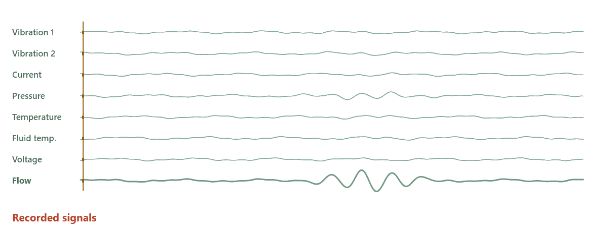
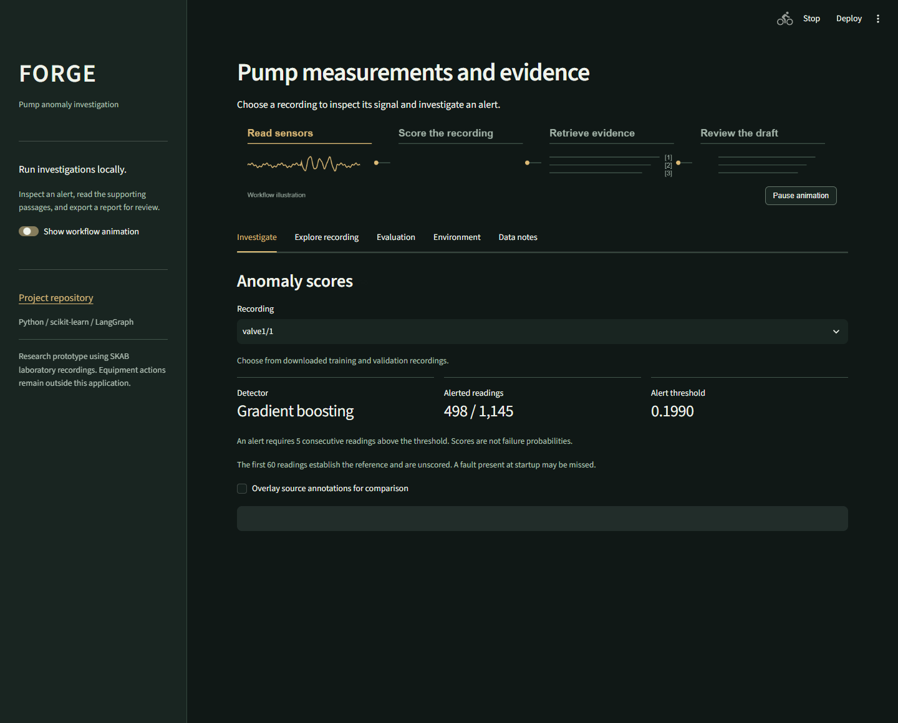
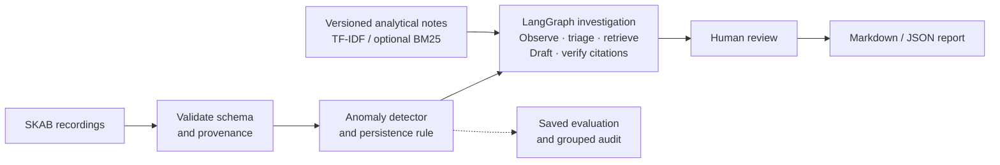
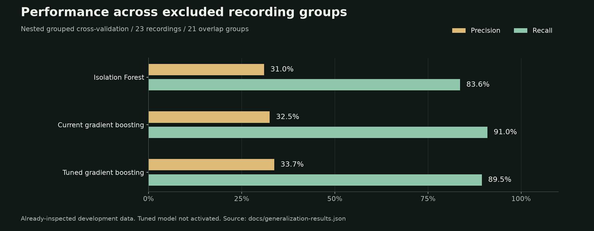
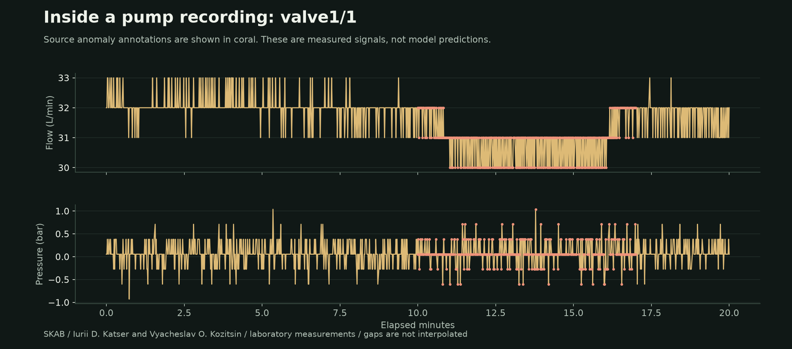

# FORGE

FORGE detects anomalies in recorded pump sensor data and drafts investigation
reports with cited analytical notes for human review.

<picture>
  <source media="(prefers-reduced-motion: reduce) and (prefers-color-scheme: dark)" srcset="docs/assets/workflow-static-dark.png">
  <source media="(prefers-reduced-motion: reduce)" srcset="docs/assets/workflow-static.png">
  <source media="(prefers-color-scheme: dark)" srcset="docs/assets/workflow-dark.gif">
  
</picture>

*Workflow illustration. Static versions: [light](docs/assets/workflow-static.png) / [dark](docs/assets/workflow-static-dark.png).*

[Run locally](#run-locally) · [Architecture](#architecture) · [Results](#what-the-models-show) · [Code walkthrough](docs/code-walkthrough.md)

## The app

The Streamlit app shows persistent alerts and cited passages for a selected
recording, with Markdown or JSON export. Reviewed reports include the reviewer's
name.



Local policy agents use TF-IDF to retrieve guidance from versioned notes written
for this project, then check its citations. Equipment-specific documentation has
yet to be added. The separate [Qwen CLI](docs/local-llm.md) uses model-selected tools
and BM25 to produce unreviewed LLM drafts through Ollama, locally or on
[EnsiCompute](docs/ensicompute.md). The [PyTorch and BM25 demo](docs/increment-demo.md)
includes an optional neural detector and BM25 retrieval.

## Architecture



Built with Python, scikit-learn, Streamlit, Plotly, LangGraph and Pydantic, FORGE has
separate modules for data loading, modeling, retrieval, orchestration and reports.
See the [architecture documentation](docs/architecture.md) for implementation details.

The optional [OPC UA capture prototype](docs/opcua-demo.md) replays a development
recording through a simulated local server. A read-only client checks eight-channel
frame completeness, quality and timing, then saves an audited capture for offline
detector comparison. The prototype has not been connected to a PLC or plant network.

## What the models show

The active detector uses supervised gradient boosting on sensor changes relative
to each recording's first 60 readings, which remain unscored. Isolation Forest is
the original baseline.



The grouped audit used five outer folds across 21 overlap groups and three inner
folds for tuning. Precision improved slightly, but false alert episodes rose from
137 to 220. The tuned model remains inactive.

Earlier model selection reached 95.1% precision and 65.8% recall on one validation
split. The lower audit scores show that performance depends on which recording
groups are held out. Both analyses reused inspected development data. Assessing
generalization requires new recordings.

A [causal score filter](docs/refinement-results.md) reduced false alert onsets from
137 to 41 under the same grouped protocol. False-positive readings fell from 16,079
to 15,836, while median detected event delay rose from 6.5 to 20.5 seconds. The
experimental filter reduced alert fragmentation but left a high false-positive rate.

The [CatBoost and TabM comparison](docs/modern-comparison-results.md) used the same
folds and features, with a histogram gradient boosting (HGB) control to isolate the
effect of threshold selection. With the precision-weighted F0.5 objective, HGB
reached 63.8% precision and 63.1% recall, ordered CatBoost 71.5% and 64.5%, and
compact TabM 83.4% and 56.1%. TabM reduced false-positive readings to 954 but
produced 216 false alert onsets, compared with CatBoost's 69. These experimental
procedures also reused development recordings.

[Grouped audit and reproduction](docs/generalization-results.md) · [Development comparison](docs/improvement-results.md) · [Historical baseline](docs/evaluation.md)

## The data



The recordings come from [SKAB](https://github.com/waico/SKAB), a laboratory pump
dataset by Iurii D. Katser and Vyacheslav O. Kozitsin. The inventory fixes source
revisions and checksums, with overlapping recordings kept in the same split.
Source annotations are excluded from model inputs and identify anomalies, not
confirmed equipment failures. See [provenance, sensors and sampling](data/README.md).

## Run locally

Verified on Windows with Python 3.13. Run from the cloned repository:

```powershell
python -m venv .venv
.\.venv\Scripts\python.exe -m pip install -r requirements-lock.txt
.\.venv\Scripts\python.exe -m pip install --no-deps --no-build-isolation -e .
.\.venv\Scripts\python.exe -m forge.data.partitions --split train --download --audit
.\.venv\Scripts\python.exe -m forge.data.partitions --split validation --download --audit
.\.venv\Scripts\python.exe -m forge train
.\.venv\Scripts\python.exe -m forge app
```

These commands train the original baseline and start the app at
[localhost:8511](http://127.0.0.1:8511), without an API key or connected equipment.
The [development comparison](docs/improvement-results.md#reproduce-and-inspect)
explains how to reproduce and activate the supervised model.

[Setup, CLI export and checks](docs/getting-started.md) · [Analysis notebooks](notebooks/)

## License

Copyright (c) 2026 Dang Duong Dang Khoa. Original code and documentation are licensed
under [Apache License 2.0](LICENSE), permitting commercial and noncommercial use
under its terms. Preserve the applicable [NOTICE](NOTICE) and
[attribution](ATTRIBUTION.md). Third-party data and dependencies keep their own licenses.
